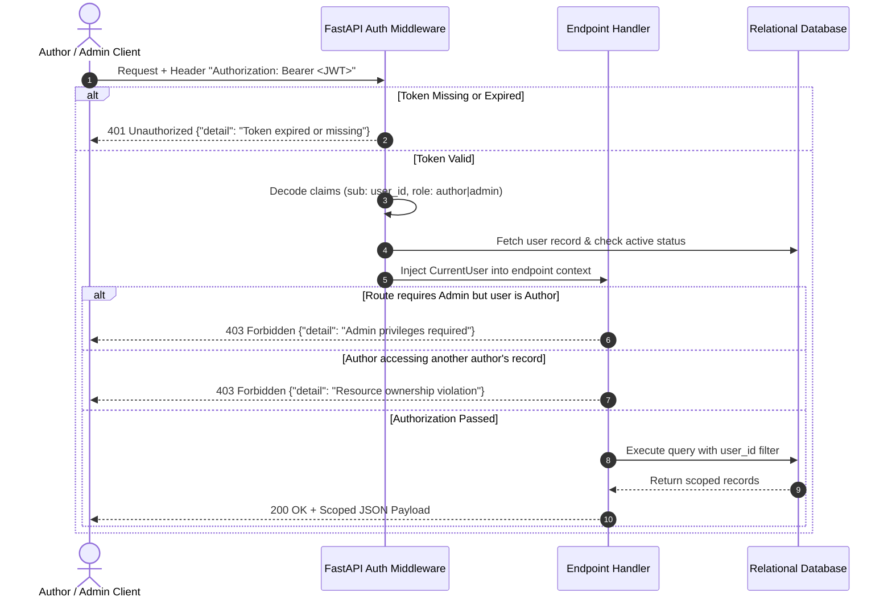
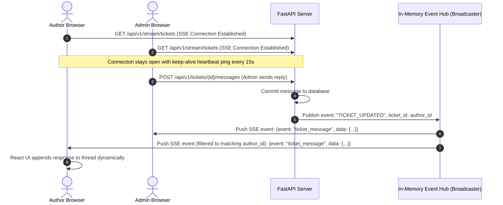
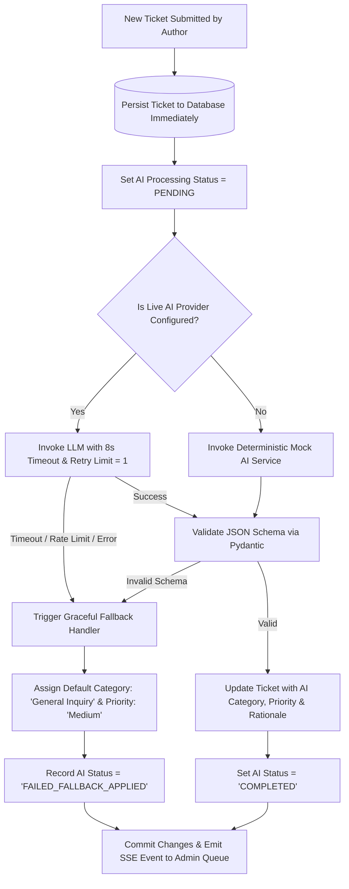

# BookLeaf Author Support & Communication Portal
# System Architecture Specification (`architecture.md`)

---

## 1. Architectural Philosophy & Objectives

The BookLeaf Author Support & Communication Portal is designed to provide an enterprise-grade, reliable, and auditable operational hub for self-publishing authors and BookLeaf's support team. 

### Core Architectural Principles
1. **Separation of Concerns:** Distinct decoupled layers for UI presentation, API orchestration, domain business logic, AI enrichment, and relational persistence.
2. **Fail-Safe Operation (Graceful Degradation):** Core transactional workflows (user login, book browsing, ticket submission, status updates, manual messaging) must succeed with 100% uptime even if external AI providers experience outages, rate limits, or network timeouts.
3. **Strict Data Isolation (Multi-Tenant Authorization):** Authors must only ever query, read, or mutate data belonging directly to their own account. Identity is strictly derived from verified server-side JWT claims—never from client-supplied request bodies or query parameters.
4. **Human-in-the-Loop AI Oversight:** AI outputs (classification, priority score, and draft responses) are treated as advisory recommendations. Ops personnel retain full override capabilities, and the system records both machine proposals and human decisions.
5. **Deterministic Testing & Reproducibility:** Every layer can be verified locally and in CI without incurring third-party API costs or requiring live external credentials, via pluggable mock providers and isolated database environments.

---

## 2. High-Level Architecture Topology

```
+----------------------------------------------------------------------------------------------------+
|                                           CLIENT TIER                                              |
|                                                                                                    |
|    +------------------------------------------+    +------------------------------------------+    |
|    |           AUTHOR PORTAL (Next.js)        |    |            ADMIN PORTAL (Next.js)        |    |
|    | - Authentication (Email/Password)        |    | - Triage Dashboard & Ticket Queue        |    |
|    | - My Books & Royalty Breakdown           |    | - Multi-Filter & Search Engine           |    |
|    | - Ticket Creation Form (Validation)      |    | - AI Draft Studio & Knowledge Inspector  |    |
|    | - My Tickets & Live Conversation Feed    |    | - Status, Priority & Category Overrides  |    |
|    | - Real-time SSE / Polling Listener       |    | - Internal Staff Notes Engine            |    |
|    +------------------------------------------+    +------------------------------------------+    |
+-----------------------------------------------------+----------------------------------------------+
                                                      |
                                                      | HTTPS / REST JSON (JWT Bearer Token)
                                                      | Real-time: Server-Sent Events (SSE)
                                                      v
+-----------------------------------------------------+----------------------------------------------+
|                                        APPLICATION / API TIER                                      |
|                                         FastAPI (Python 3.10+)                                     |
|                                                                                                    |
|    +------------------------------------------------------------------------------------------+    |
|    |                                API ROUTERS & MIDDLEWARE                                  |    |
|    | - CORS Middleware (Restricted to frontend origins)                                       |    |
|    | - Authentication & RBAC Guard (`get_current_user`, `require_author`, `require_admin`)    |    |
|    | - Request ID & Audit Logging Middleware                                                  |    |
|    | - Structured Error Handling & Exception Handlers (RFC 7807 compliant)                    |    |
|    +------------------------------------------------------------------------------------------+    |
|                                                      |                                             |
|        +---------------------+-----------------------+-----------------------+                     |
|        |                     |                       |                       |                     |
|        v                     v                       v                       v                     |
|  +-------------+      +--------------+        +--------------+        +---------------+            |
|  | Auth Module |      | Books Module |        | Ticket Engine|        | Real-Time Hub |            |
|  | - Login     |      | - Catalog    |        | - Lifecycle  |        | - SSE Stream  |            |
|  | - JWT Mint  |      | - Royalties  |        | - Validation |        | - Event Bus   |            |
|  | - Passwords |      | - Isolation  |        | - Messages   |        | - Fallback    |            |
|  +-------------+      +--------------+        +--------------+        +---------------+            |
|                                                      |                                             |
+------------------------------------------------------|---------------------------------------------+
                                                       |
                        +------------------------------+------------------------------+
                        |                                                             |
                        v                                                             v
+-----------------------------------------------+             +-----------------------------------------------+
|                DATA TIER                      |             |             AI / ENRICHMENT TIER              |
|                                               |             |                                               |
|  +-----------------------------------------+  |             |  +-----------------------------------------+  |
|  |          Relational Database            |  |             |  |      Pluggable AIService Interface      |  |
|  |    PostgreSQL (Prod) / SQLite (Dev)     |  |             |  | - ClassifyCategory(query, book_meta)    |  |
|  | - Users, Roles & Credentials            |  |             |  | - ScorePriority(query, urgency, impact) |  |
|  | - Books, Formats, Royalties, Sales      |  |             |  | - GenerateDraft(query, book, KB_chunks) |  |
|  | - Tickets, Messages, Internal Notes     |  |             |  +-----------------------------------------+  |
|  | - AI Logs & Human Overrides             |  |             |                       |                       |
|  +-----------------------------------------+  |             |        +--------------+--------------+        |
|  |       SQLAlchemy 2.0 ORM + Alembic      |  |             |        |                             |        |
|  | - Strict Foreign Keys & Unique Indicies |  |             |        v                             v        |
|  | - ACID Transactions & Prepared Stmts    |  |             |  +--------------+             +--------------+  |
|  +-----------------------------------------+  |             |  | Live LLM     |             | Deterministic|  |
+-----------------------------------------------+             |  | Provider     |             | Mock AI      |  |
                                                              |  | (OpenAI /    |             | Provider     |  |
                                                              |  | Anthropic /  |             | (Local/CI/   |  |
                                                              |  | Gemini)      |             | Fallback)    |  |
                                                              |  +--------------+             +--------------+  |
                                                              +-----------------------------------------------+
```

---

## 3. Technology Stack & Decision Rationale

| Component | Selected Technology | Alternative Considered | Decision Justification |
| :--- | :--- | :--- | :--- |
| **Backend API** | **FastAPI (Python 3.10+)** | Node.js (Express/NestJS) | Native asynchronous support, automatic OpenAPI/Swagger documentation, strict type validation via Pydantic v2, and clean integration with AI/LLM SDKs. |
| **Frontend UI** | **Next.js (App Router) + Tailwind CSS** | Plain React SPA / Vue.js | Server components where helpful, responsive layouts, rapid prototyping with Tailwind utility classes, clean folder-based routing, and simple Vercel/Node deployment. |
| **Database & ORM** | **PostgreSQL + SQLAlchemy 2.0 + Alembic** | MongoDB (NoSQL) | Financial consistency (royalties earned vs paid), strict foreign keys, transactional integrity across tickets and notes, and schema migration history via Alembic. |
| **Authentication** | **JWT (Stateless Bearer Tokens) + bcrypt** | Session cookies + Redis | Clean REST separation, eliminates Redis infrastructure dependency for an evaluation assignment, and easily inspected and tested via Swagger UI. |
| **Real-Time Layer** | **Server-Sent Events (SSE) + Long-polling fallback** | Full WebSockets | SSE is unidirectional (server-to-client updates), HTTP/2 compatible, simpler to debug through proxies, and avoids heavy bidirectional WebSocket connection state. |
| **AI Integration** | **Provider Abstraction (`AIService`)** | Hardcoded OpenAI calls | Allows instant switching between OpenAI (`gpt-4o-mini`), Claude (`claude-3-haiku`), Gemini, and a deterministic offline mock provider when no API keys are present. |

---

## 4. Security Architecture & Boundary Controls

### 4.1 Authentication & Role-Based Access Control (RBAC)
The system distinguishes two primary roles:
- `author`: Restricted strictly to personal profile, own books, and submitted support tickets.
- `admin`: Operations staff possessing complete system visibility across all authors, books, tickets, internal notes, and AI drafting tools.



### 4.2 Data Protection & Confidentiality Rules
1. **Internal Notes Privacy:** Internal notes (`InternalNote` entity) created by support staff are strictly excluded from all author-facing DTOs/schemas. Endpoints serving authors filter out internal notes at the SQL query level.
2. **Preventing Cross-Author Access:** Ticket creation verifies that any supplied `book_id` actually belongs to the authenticated `user_id`. Attempting to associate a ticket with another author's book immediately yields `403 Forbidden`.
3. **Password Security:** Passwords hashed with `bcrypt` (work factor 12). Raw passwords never logged, stored, or echoed back.
4. **Credential Isolation:** API keys for LLMs and JWT secrets reside exclusively in backend environment variables (`.env`). The client application has zero access to third-party AI keys.
5. **Prompt Injection Mitigation:** User ticket subjects and descriptions are treated as untrusted data. They are wrapped in explicit delimiter boundaries (`"""`) in system prompts to prevent override of system instructions.

---

## 5. Comprehensive REST API & HTTP Status Code Registry

Every endpoint conforms to standard REST semantic conventions. Below is the complete catalog of status codes employed across the application, with concrete trigger scenarios and error schemas.

### 5.1 HTTP Status Code Catalog

| Status Code | Standard Name | Usage & Trigger Scenarios in BookLeaf Portal |
| :--- | :--- | :--- |
| **`200 OK`** | Standard Success | Successful `GET` requests (retrieving books, ticket lists, ticket details, AI drafts) and successful `PATCH`/`PUT` updates (updating ticket status, overriding category). |
| **`201 Created`** | Resource Created | Successful `POST` operations creating a new persistent entity (user registration, ticket submission, adding a message or internal note). Returns the newly created entity with its assigned ID and timestamps. |
| **`204 No Content`** | Action Completed | Successful operations that return an empty body (e.g., ticket deletion where applicable, or session invalidation). |
| **`400 Bad Request`** | Malformed Request | Client sent logically invalid business data (e.g., attempting to change ticket status to an invalid transition, such as from `Closed` back to `Open` without proper permission, or invalid query parameters). |
| **`401 Unauthorized`** | Authentication Failure | Missing `Authorization` header, invalid JWT signature, expired token, or incorrect login credentials. |
| **`403 Forbidden`** | Authorization Violation | Authenticated user lacks permission to access the resource (e.g., an author attempting to view another author's ticket, an author calling an admin endpoint, or an author linking a book they do not own). |
| **`404 Not Found`** | Resource Non-Existent | The requested `ticket_id`, `book_id`, or `user_id` does not exist in the database. |
| **`409 Conflict`** | State Conflict | Attempting to register an email address that already exists, or concurrent state modification conflict. |
| **`422 Unprocessable Entity`** | Schema Validation Failure | Automatic FastAPI/Pydantic validation error when request body fields fail type, length, or regex constraints (e.g., missing required `subject`, invalid email format, empty description). |
| **`429 Too Many Requests`** | Rate Limit Exceeded | Triggered if an author submits tickets excessively or if the AI drafting endpoint is called faster than the allowed rate limit threshold. |
| **`500 Internal Server Error`** | Unhandled Server Exception | Unexpected database connection failure or code exception. Handled by a global exception middleware that masks internal tracebacks from production clients while logging the full traceback securely. |
| **`502 Bad Gateway`** | Upstream Provider Failure | Received an invalid or broken response from the upstream LLM provider when live AI integration is enabled. |
| **`503 Service Unavailable`** | Service Temporarily Offline | Upstream AI provider is experiencing a full outage or timeout, signaling the client that fallback mock mode is engaging. |
| **`504 Gateway Timeout`** | Upstream Timeout | Third-party LLM call timed out after the configured deadline (e.g., 8 seconds), triggering immediate graceful degradation to fallback classification/priority defaults. |

---

## 6. Standardized Error Response Specification

All error responses across the API follow a uniform RFC 7807-inspired JSON structure:

```json
{
  "error": {
    "code": "RESOURCE_OWNERSHIP_VIOLATION",
    "message": "You do not have permission to attach Book ID 'BK003' to this ticket.",
    "status": 403,
    "timestamp": "2026-10-25T17:15:00Z",
    "details": [
      {
        "field": "book_id",
        "issue": "Book does not belong to authenticated author AUTH001"
      }
    ]
  }
}
```

---

## 7. Endpoint Architecture & Routing Map

```
/api/v1/
├── auth/
│   ├── POST   /login              # Authenticate credentials -> returns JWT token + user profile
│   ├── GET    /me                 # Returns currently authenticated user context
│   └── POST   /logout             # Invalidate client session
│
├── books/
│   ├── GET    /                   # Author: List own books | Admin: List books across catalog (paginated)
│   ├── GET    /{book_id}          # Retrieve specific book details & sales/royalty metrics
│   └── GET    /summary/royalties  # Aggregate royalty statistics (Total Earned, Paid, Pending)
│
├── tickets/
│   ├── GET    /                   # Author: List own tickets | Admin: Triage queue with multi-filters
│   ├── POST   /                   # Author: Submit support query (triggers async AI enrichment)
│   ├── GET    /{ticket_id}        # Retrieve ticket details & public message thread
│   ├── PATCH  /{ticket_id}        # Admin: Update status, assign staff, or override category/priority
│   │
│   ├── POST   /{ticket_id}/messages       # Post public reply (Admin to Author, or Author follow-up)
│   ├── GET    /{ticket_id}/internal-notes # Admin only: Retrieve internal private staff notes
│   └── POST   /{ticket_id}/internal-notes # Admin only: Create internal private staff note
│
├── ai/
│   ├── POST   /classify           # Classify ticket into 1 of 6 categories (with confidence & rationale)
│   ├── POST   /priority           # Score priority (Critical, High, Medium, Low) with rationale
│   └── POST   /draft-response     # Generate empathetic, KB-grounded response draft
│
└── stream/
    └── GET    /tickets            # Server-Sent Events (SSE) stream for real-time ticket & message events
```

---

## 8. Real-Time Communication Architecture (SSE + Polling)

To satisfy the requirement that ticket updates reach authors and admins without a full page refresh:



### Fallback Guarantee
If the client's browser, network proxy, or corporate firewall drops the SSE connection:
- The frontend client automatically detects the disconnect.
- It attempts reconnection with exponential backoff (1s, 2s, 4s, 8s).
- If reconnection fails after 3 attempts, it gracefully switches to an automated **lightweight polling interval (every 8 seconds)** until connectivity stabilizes.

---

## 9. AI Service Layer & Graceful Degradation Pipeline

The `AIService` operates with strict timeout boundaries and defensive fallbacks:



---

## 10. Database Concurrency & Transaction Management

- **ACID Transactions:** Every ticket state transition, message posting, and note creation runs within explicit database transactions (`async with session.begin():`).
- **Connection Pooling:** SQLAlchemy connection pool configured with `pool_size=10`, `max_overflow=20`, and `pool_pre_ping=True` to detect stale connections.
- **Index Optimization:** Database indexes placed on `tickets.author_id`, `tickets.status`, `tickets.priority`, `tickets.category`, and `tickets.created_at` to ensure sub-millisecond query performance on large ticket queues.
