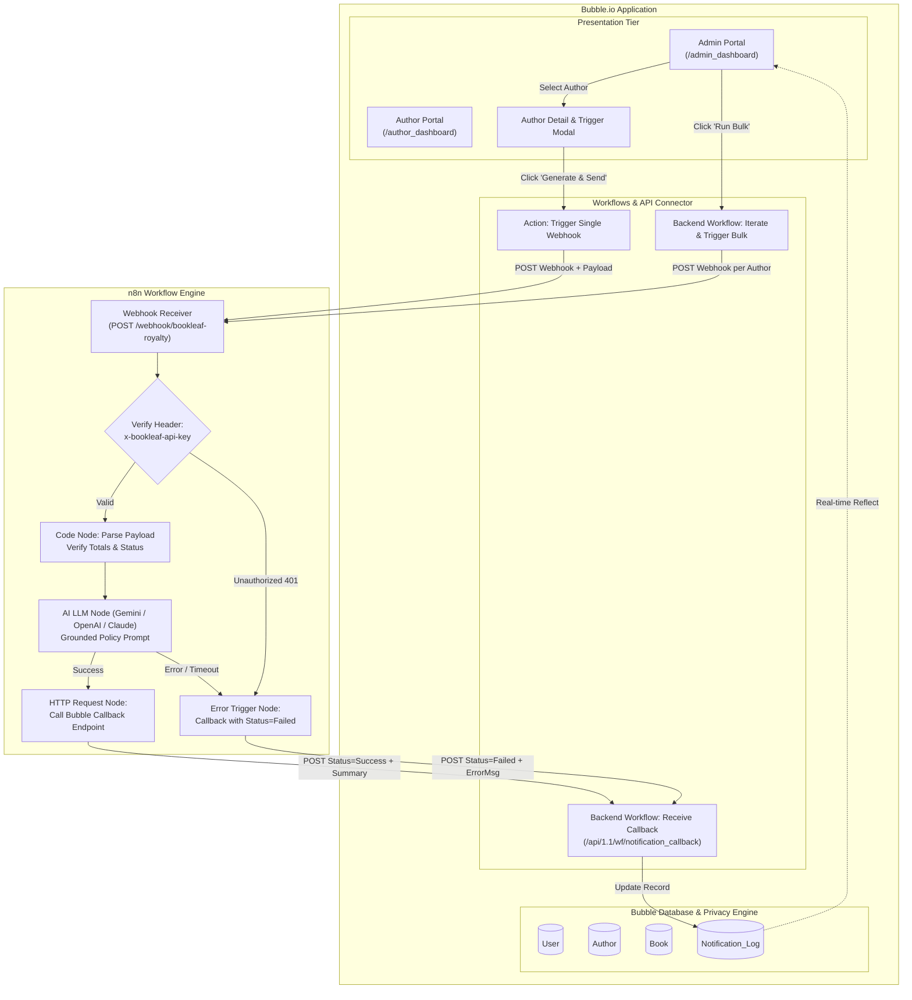
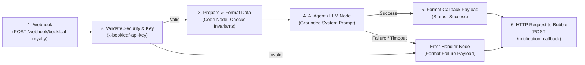
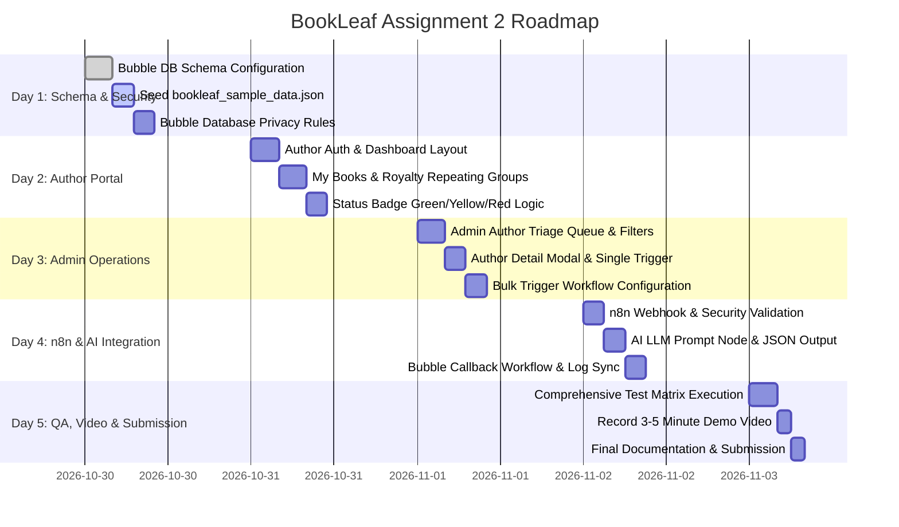

# BookLeaf Publishing — Assignment 2 Master Implementation Plan
## Author Royalty Dashboard & Automated Notification System (Bubble.io + n8n + AI Integration)

---

## 1. Assignment Understanding & Executive Summary

### 1.1 The Business Problem
BookLeaf Publishing processes **1,200+ books monthly** across **22,000+ active catalog titles**, working with thousands of self-published authors across India and the United States. Authors care deeply about:
1. Exact sales volumes and royalties earned on each platform (Amazon, Flipkart, BookLeaf Store).
2. Transparent visibility into pending payout balances and payout timing.
3. Accurate status tracking for titles still in production pipelines (Cover Design, Typesetting).

Currently, BookLeaf runs its core dashboard and operations on **Bubble.io** and background automations on **n8n**. The manual task of calculating author royalties, drafting personalized email updates, and communicating payout schedules at scale causes support bottlenecks. 

### 1.2 Assignment 2 Core Mandate
Deliver a production-ready, secure, and verifiable prototype consisting of:
1. **Bubble.io Web Application:**
   - Multi-tenant relational database populated with the official `bookleaf_sample_data.json` dataset (10 authors, 18 books).
   - Strict database-level **Privacy Rules** preventing authors from seeing other authors' books, royalties, or admin data.
   - **Author Portal:** Catalog overview, per-book royalty breakdown, consolidated totals, and dynamic **Royalty Status Badges** (Green / Yellow / Red).
   - **Admin Portal:** Author queue with city and payout status filters, author detail page with single-author notification trigger, and a bulk trigger for all authors with pending balances.
   - **Notification Log:** Live tracking table updating to `Success` or `Failed` only upon completion of the automated process.
2. **n8n Automation Workflow:**
   - Authenticated webhook receiver (`x-bookleaf-api-key`).
   - Deterministic financial calculation & validation (enforcing $earned - paid = pending$).
   - AI API integration (OpenAI `gpt-4o-mini`, Anthropic `claude-3-haiku`, or Google Gemini) with zero-hallucination prompts grounded in BookLeaf's 80/20 net profit formula, quarterly payout cycles, 45-day payout windows, and ₹1,000 threshold.
   - Callback to Bubble to persist the generated email text and update the Notification Log status.
   - Idempotency guards and comprehensive error handling.

---

## 2. Comprehensive Requirements Checklist

| Requirement Area | Specification / Feature | Target Component | Status |
| :--- | :--- | :--- | :---: |
| **Database** | Relational data types (`User`, `Author`, `Book`, `Notification_Log`) with 1-to-many links | Bubble Data Tab | Planned |
| **Database** | Exact `bookleaf_sample_data.json` dataset seeded (10 authors, 18 books, edge cases) | Bubble App Data | Planned |
| **Privacy Rules** | Authors can only view their own Author, Book, and Log records | Bubble Privacy Tab | Planned |
| **Privacy Rules** | Admins have full read/write access across all data types | Bubble Privacy Tab | Planned |
| **Author Portal** | Email & password authentication with role-based routing | Bubble Workflow / Login | Planned |
| **Author Portal** | My Books table (Title, ISBN, Genre, Status, Publication Date, MRP, Channels) | Bubble Repeating Group | Planned |
| **Author Portal** | Per-book royalties (Copies Sold, Total Earned, Paid, Pending, Last Payout Date) | Bubble Repeating Group | Planned |
| **Author Portal** | Consolidated author balance sheet (Total Earned, Total Paid, Total Pending) | Bubble Summary Elements | Planned |
| **Author Portal** | Royalty Status Badge: Green (Paid), Yellow (Pending $\le 90$d), Red (Overdue $> 90$d) | Bubble Conditional Logic | Planned |
| **Admin Portal** | Master author list (Name, City, Book Count, Total Earned, Pending Balance) | Bubble Repeating Group | Planned |
| **Admin Portal** | Filtering by City & Payout Status (Fully Paid, Pending, Overdue) + Name Search | Bubble Search & Filters | Planned |
| **Admin Portal** | Author Detail Page / Popup with complete catalog & payout metrics | Bubble Visual Element | Planned |
| **Admin Portal** | Single Trigger: "Generate & Send Royalty Summary" button triggering n8n | Bubble Workflow | Planned |
| **Admin Portal** | Bulk Trigger: "Run Bulk Royalty Notifications" for all authors with pending balance | Bubble Backend Workflow | Planned |
| **Admin Portal** | Notification Log table showing Author, Timestamp, and live Status | Bubble Repeating Group | Planned |
| **n8n Workflow** | Webhook endpoint listening for authenticated requests from Bubble | n8n Webhook Node | Planned |
| **n8n Workflow** | Security validation via `x-bookleaf-api-key` header | n8n IF / Code Node | Planned |
| **n8n Workflow** | Payload validation & financial checks ($earned - paid = pending$, ₹1,000 threshold) | n8n Code Node | Planned |
| **n8n Workflow** | AI Agent / LLM node generating grounded royalty email matching BookLeaf tone | n8n AI / HTTP Node | Planned |
| **n8n Workflow** | Callback to Bubble API updating `Notification_Log` status & generated content | n8n HTTP Request Node | Planned |
| **n8n Workflow** | Error handling path updating status to `Failed` with diagnostic error message | n8n Error Trigger / IF | Planned |
| **n8n Workflow** | Idempotency guard preventing duplicate triggers on multiple clicks / retries | n8n / Bubble Logic | Planned |
| **Documentation**| Complete setup guide, schema rationale, prompt architecture, and video script | `assignment2/README.md` | Planned |

---

## 3. Dataset Analysis & Relational Mapping (`bookleaf_sample_data.json`)

### 3.1 Dataset Entities & Integrity Invariants
- **10 Authors (`AUTH001` - `AUTH010`):**
  - All sample emails use `@email.com` (e.g., `priya.sharma@email.com`, `ananya.reddy@email.com`, `kavita.deshmukh@email.com`).
  - Passwords follow standard test format: `Author123!` (Admin: `Admin123!`).
- **18 Books (`BK001` - `BK018`):**
  - Strict financial invariant: For every book, `total_royalty_earned - royalty_paid == royalty_pending`.

### 3.2 Specific Author Test Personas & Edge Cases
1. **Fully Paid Author — Priya Sharma (`AUTH001`):**
   - 2 books (*Whispers of the Ganges*, *The Saffron Diaries*).
   - *The Saffron Diaries* has ₹0 pending. 
   - Ideal for testing **Green** badge and positive acknowledgment when all royalties are settled.
2. **Pending Royalties Eligible for Payout — Ananya Reddy (`AUTH003`):**
   - 2 books (*Echoes of the Deccan*, *Silent Monsoon*).
   - *Echoes of the Deccan* has ₹2,546 pending, last payout date `null`.
   - Exceeds the ₹1,000 threshold: ideal for testing quarterly cycle payout explanation.
3. **Normal Payout Cycle Pending — Vikram Joshi (`AUTH004`):**
   - *The Pune Express* has ₹4,800 pending, last payout was `2024-06-30`.
   - Ideal for testing **Yellow** status badge.
4. **Overdue Payout (> 90 Days / No Prior Payout) — Arjun Malhotra (`AUTH006`):**
   - *Beyond the Mustard Fields* (BK010) published `2023-11-15` with ₹2,464 pending and no prior payout (`last_royalty_payout_date = null`).
   - Published $> 90$ days ago with zero payouts: triggers **Red** badge.
5. **Books in Production Pipeline — Sneha Kulkarni (`AUTH007`) & Farhan Sheikh (`AUTH008`):**
   - BK015 (*Raising Roots*) is `"In Production - Typesetting"`.
   - BK013 (*Midnight in Mysore*) is `"In Production - Cover Design"`.
   - Null publication dates, zero royalties, no print partners: AI prompt must transparently report production status without fabricating financial numbers.
6. **Sub-Threshold Rollover — Kavita Deshmukh (`AUTH009`):**
   - *Midnight Musings* (BK016) has earned ₹850, paid ₹0, pending ₹850.
   - Earned amount is **below the ₹1,000 minimum threshold**: AI prompt must explain that ₹850 rolls over to next quarter without making an unauthorized payout promise.

---

## 4. System Architecture & Component Interaction



---

## 5. Bubble.io Database Schema Specification

Bubble does not use traditional SQL DDL statements; data types and fields are configured via Bubble's **Data** tab.

### 5.1 Data Type: `User`
| Field Name | Field Type | Description / Constraints |
| :--- | :--- | :--- |
| `email` | text (built-in) | Unique user login email address |
| `role` | text | Either `"author"` or `"admin"` |
| `author_profile` | `Author` | 1-to-1 link to the Author data record |

### 5.2 Data Type: `Author`
| Field Name | Field Type | Description / Constraints |
| :--- | :--- | :--- |
| `author_id` | text | External ID from dataset (e.g., `AUTH001`) |
| `name` | text | Full legal author name |
| `email` | text | Primary contact email |
| `phone` | text | Formatted telephone number |
| `city` | text | Indian metro / tier-2 city name |
| `joined_date` | date | Author onboarding date |
| `user` | `User` | Bidirectional link to the authenticated User |
| `books` | List of `Book` | 1-to-many relationship with books written by author |
| `cached_total_earned` | number | Calculated sum of `total_royalty_earned` across books |
| `cached_total_paid` | number | Calculated sum of `royalty_paid` across books |
| `cached_total_pending`| number | Calculated sum of `royalty_pending` across books |
| `cached_payout_status`| text | `"Fully Paid"`, `"Pending"`, or `"Overdue"` |

### 5.3 Data Type: `Book`
| Field Name | Field Type | Description / Constraints |
| :--- | :--- | :--- |
| `book_id` | text | External ID (e.g., `BK001`) |
| `author` | `Author` | Foreign link to parent Author entity |
| `title` | text | Book Title |
| `isbn` | text | Formatted ISBN or empty text if in production |
| `genre` | text | Genre classification |
| `publication_date` | date | Date live, or empty if in production |
| `status` | text | `"Published & Live"`, `"In Production - Cover Design"`, etc. |
| `mrp` | number | Retail price in INR |
| `author_royalty_per_copy`| number | Contracted per-copy royalty |
| `total_copies_sold` | number | Total lifetime sales units |
| `total_royalty_earned` | number | Total earnings ($copies \times royalty$) |
| `royalty_paid` | number | Historical disbursed amount |
| `royalty_pending` | number | Outstanding balance ($earned - paid$) |
| `last_royalty_payout_date`| date | Date of last bank transfer, or empty |
| `print_partner` | text | `"In-House"`, `"Repro India"`, `"Epitome Books"`, or empty |
| `available_on` | List of texts | Active channels (Amazon, Flipkart, BookLeaf Store) |

### 5.4 Data Type: `Notification_Log`
| Field Name | Field Type | Description / Constraints |
| :--- | :--- | :--- |
| `author` | `Author` | Author for whom notification was generated |
| `trigger_type` | text | `"single"` or `"bulk"` |
| `status` | text | `"Pending"`, `"Success"`, or `"Failed"` |
| `trigger_timestamp` | date | When the request was initiated from Bubble |
| `completion_timestamp`| date | When n8n returned the completed callback |
| `generated_summary` | text | The full AI-generated email text returned by n8n |
| `error_message` | text | Diagnostic error description if status is `"Failed"` |
| `idempotency_key` | text | Unique string (`author_id + "-" + timestamp`) preventing duplicates |

---

## 6. Privacy & Security Rules Specification

Configured in Bubble under **Data $\rightarrow$ Privacy**.

### 6.1 Rules for Data Type `Author`
- **Rule 1 (Admin Access):** `Current User's role is "admin"`
  - Can view all fields: Yes
  - Can find in searches: Yes
  - Can view attached files: Yes
- **Rule 2 (Author Self Access):** `Current User's author_profile is This Author`
  - Can view all fields: Yes
  - Can find in searches: Yes
- **Everyone else (Default):**
  - Can view all fields: **NO** (uncheck all)
  - Can find in searches: **NO**

### 6.2 Rules for Data Type `Book`
- **Rule 1 (Admin Access):** `Current User's role is "admin"`
  - Full permissions
- **Rule 2 (Author Self Access):** `This Book's author's user is Current User`
  - Full read permissions
- **Everyone else (Default):**
  - View permissions: **NO**

### 6.3 Rules for Data Type `Notification_Log`
- **Rule 1 (Admin Access):** `Current User's role is "admin"`
  - Full read/write permissions
- **Rule 2 (Author Self Access):** `This Notification_Log's author's user is Current User`
  - View `author`, `trigger_timestamp`, `generated_summary`, `status`
- **Everyone else (Default):**
  - View permissions: **NO**

---

## 7. Royalty Calculation & Status Logic

### 7.1 Consolidated Calculations
Calculated at the author level via Bubble expressions:
- **Total Earned:** `Current User's author_profile's books's total_royalty_earned:sum`
- **Total Paid:** `Current User's author_profile's books's royalty_paid:sum`
- **Total Pending:** `Current User's author_profile's books's royalty_pending:sum`

### 7.2 Exact Status Badge Logic (Green / Yellow / Red)

```mermaid
flowchart TD
    Start([Calculate Author Status]) --> CheckPaid{Is Total Pending == 0?}
    CheckPaid -- Yes --> Green["GREEN: Fully Paid\n(All royalties settled)"]
    CheckPaid -- No --> CheckOverdue1{Has Author received payouts before?\n(last_royalty_payout_date is not empty)}
    
    CheckOverdue1 -- Yes --> CheckDate{"Is Last Payout Date < (Current Date - 90 days)?"}
    CheckDate -- Yes --> Red["RED: Overdue / Action Required\n(Pending > 0 and payout > 90 days ago)"]
    CheckDate -- No --> Yellow["YELLOW: Pending (Normal Cycle)\n(Pending > 0 within quarterly cycle)"]
    
    CheckOverdue1 -- No --> CheckPubDate{"Is Book Publication Date < (Current Date - 90 days)?"}
    CheckPubDate -- Yes --> Red
    CheckPubDate -- No --> Yellow
```

#### Exact Bubble Conditional Expressions for Badge Element:
1. **Default State (Yellow - Pending):**
   - Background: `#fef3c7` (amber-100), Text: `#92400e` (amber-800), Label: `"Pending"`
2. **Condition 1 (Green - Fully Paid):**
   - Expression: `Parent group's Author's cached_total_pending is 0`
   - Background: `#ecfdf5` (emerald-100), Text: `#065f46` (emerald-800), Label: `"Fully Paid"`
3. **Condition 2 (Red - Overdue):**
   - Expression: 
     `Parent group's Author's cached_total_pending > 0 and (`  
     `Parent group's Author's books:filtered(last_royalty_payout_date < Current date/time +(days): -90):count > 0`  
     `or Parent group's Author's books:filtered(last_royalty_payout_date is empty and publication_date < Current date/time +(days): -90):count > 0 )`
   - Background: `#fef2f2` (rose-100), Text: `#991b1b` (rose-800), Label: `"Overdue (>90 Days)"`

---

## 8. Bubble.io UI & Page Architecture

We implement a clean, single-page application (SPA) architecture with two distinct portal views or dedicated pages:

### 8.1 Page: `author_dashboard`
- **Top Bar:** BookLeaf Publishing logo, Author Name, Role tag (`Author`), and Sign Out button.
- **Consolidated Balance Sheet Card (Asymmetric 2-Column Layout):**
  - Left: Lifetime Earned, Settled Transfers, Outstanding Balance.
  - Right: Payout Eligibility notice (Explaining the ₹1,000 threshold status).
- **My Books Repeating Group:**
  - Table / Card rows showing Title, Genre, Publication Status, ISBN, Copies Sold, MRP, Earned, Paid, Pending, and Status Badge.

### 8.2 Page: `admin_dashboard`
- **Top Bar:** BookLeaf Publishing Operations Desk, Admin Name, Sign Out button.
- **Triage Action Bar:**
  - Search input: Type-ahead filtering on Author Name.
  - City dropdown: Unique list of cities (`Delhi`, `Mumbai`, `Bangalore`, etc.).
  - Payout status dropdown: `All`, `Fully Paid`, `Pending`, `Overdue`.
  - Action Button: **"Run Bulk Royalty Notifications"** (triggers batch processing).
- **Author Triage Repeating Group:**
  - Columns: Author Name, City, Books Count, Total Earned, Pending Balance, Status Badge, and an **"Inspect & Notify"** button.
- **Author Detail Popup / View:**
  - Full author contact information.
  - Book breakdown table.
  - Action Button: **"Generate & Send Royalty Summary"** (Calls n8n webhook for this single author).
- **Notification Log Table:**
  - Repeating group bound to `Do a search for Notification_Logs` sorted by `trigger_timestamp` descending.
  - Columns: Author Name, Triggered At, Completed At, Status (`Pending`, `Success`, `Failed`), and **"View Summary"** button to open the full email in a clean popup.

---

## 9. Bubble-to-n8n Integration Contract & Architectural Decision

### 9.1 Option Comparison: Option A vs. Option B
- **Option A (Lightweight ID Push):**
  - Bubble sends only `{"author_id": "AUTH003", "notification_id": "12345"}`.
  - n8n must make 2–3 authenticated HTTP calls back to Bubble's Data API to fetch Author and Books data.
  - *Drawbacks:* Requires configuring Bubble Data API tokens, pagination, and multiple network hops. On Bubble Free tier, Data API rate limits can cause latency and bulk timeouts.
- **Option B (Full Payload Push — RECOMMENDED):**
  - When the admin clicks "Generate & Send", Bubble bundles the author's complete profile, book array, and pre-calculated totals into a single JSON payload sent to the webhook.
  - *Benefits:* Instantaneous, atomic, zero extra API roundtrips, immune to Bubble Data API read limits, and 100% testable in n8n with reproducible test mocks.

### 9.2 Recommendation: **Option B (Full Payload Push)** with a **Lightweight Callback**
Bubble sends the complete author snapshot to n8n. n8n executes the AI prompt and calls Bubble's backend endpoint `/api/1.1/wf/notification_callback` with only the completion result:
```json
{
  "notification_id": "1730283000x123456789",
  "status": "Success",
  "generated_summary": "Dear Ananya,\n\nHere is your official BookLeaf Publishing royalty statement...",
  "error_message": null
}
```

### 9.3 Webhook Request Contract (Bubble $\rightarrow$ n8n)
- **Method:** `POST`
- **URL:** `https://<n8n-instance-or-ngrok>/webhook/bookleaf-royalty`
- **Headers:**
  - `Content-Type: application/json`
  - `x-bookleaf-api-key: bk_live_sec_89f02c78a1bc402`
- **Payload Schema:**
```json
{
  "notification_id": "1730283000x123456789",
  "idempotency_key": "AUTH003-1730283000",
  "trigger_type": "single",
  "author": {
    "author_id": "AUTH003",
    "name": "Ananya Reddy",
    "email": "ananya.reddy@email.com",
    "phone": "+91-98765-43212",
    "city": "Hyderabad",
    "joined_date": "2023-08-10"
  },
  "summary": {
    "total_earned": 14506,
    "total_paid": 11960,
    "total_pending": 2546,
    "status_badge": "Yellow",
    "eligible_for_payout": true
  },
  "books": [
    {
      "book_id": "BK005",
      "title": "Echoes of the Deccan",
      "isbn": "978-93-5XXXX-05-9",
      "status": "Published & Live",
      "publication_date": "2023-11-05",
      "mrp": 499,
      "total_copies_sold": 286,
      "total_royalty_earned": 13728,
      "royalty_paid": 11182,
      "royalty_pending": 2546,
      "last_royalty_payout_date": null
    },
    {
      "book_id": "BK004",
      "title": "Silent Monsoon",
      "isbn": "978-93-5XXXX-04-2",
      "status": "Published & Live",
      "publication_date": "2024-02-14",
      "mrp": 299,
      "total_copies_sold": 31,
      "total_royalty_earned": 778,
      "royalty_paid": 778,
      "royalty_pending": 0,
      "last_royalty_payout_date": "2025-11-20"
    }
  ]
}
```

---

## 10. n8n Node-by-Node Workflow Architecture



### Detailed Node Specifications:
1. **Webhook Node (`bookleaf_webhook`):**
   - HTTP Method: `POST`
   - Path: `/bookleaf-royalty`
   - Response Mode: `On Received` with `{"received": true, "status": "processing"}` immediately to release Bubble's visual client.
2. **IF Node (`check_api_key`):**
   - Condition: `$headers['x-bookleaf-api-key'] === 'bk_live_sec_89f02c78a1bc402'`
3. **Code Node (`format_royalty_context`):**
   - Validates that `total_earned == total_paid + total_pending`.
   - Identifies whether the author is above or below the ₹1,000 threshold.
   - Formats a compact, clean context block for the LLM.
4. **AI LLM Node (`generate_royalty_email`):**
   - Calls OpenAI (`gpt-4o-mini`), Anthropic, or Gemini.
   - Temperature: `0.1` (Strictly deterministic, zero creative fabrication).
5. **HTTP Request Node (`callback_to_bubble`):**
   - Method: `POST`
   - URL: `https://<bubble-app>.bubbleapps.io/version-test/api/1.1/wf/notification_callback`
   - Body: `{"notification_id": $json.notification_id, "status": "Success", "generated_summary": $json.email_text}`

---

## 11. Grounded AI Prompt Engineering Template

```text
You are the Senior Author Royalty Specialist at BookLeaf Publishing.
Your task is to draft a formal, warm, and 100% factually accurate quarterly royalty summary email to a published author based STRICTLY on the verified data below.

OFFICIAL BOOKLEAF KNOWLEDGE BASE RULES:
1. Royalty Policy: Calculated quarterly; disbursed within 45 calendar days following quarter close.
2. Minimum Threshold: ₹1,000. 
   - If pending balance >= ₹1,000, explain it is scheduled for the upcoming quarterly payout run.
   - If pending balance < ₹1,000, explain that earnings below ₹1,000 automatically roll over to the subsequent quarter.
   - If pending balance is 0, congratulate the author and affirm that all royalties are fully settled.
3. Production Titles: For titles in production (e.g. Cover Design or Typesetting), explain that sales and royalty reporting will begin once the book is published and live.
4. STRICT NEGATIVE CONSTRAINT: Never invent sales numbers, dates, platform transaction IDs, or payment guarantees outside these rules.

AUTHOR DATA:
- Author Name: {{ $json.author.name }}
- Contact Email: {{ $json.author.email }}
- City: {{ $json.author.city }}

CONSOLIDATED FINANCIAL METRICS:
- Lifetime Royalty Earned: ₹{{ $json.summary.total_earned }}
- Royalties Disbursed: ₹{{ $json.summary.total_paid }}
- Current Pending Balance: ₹{{ $json.summary.total_pending }}
- Payout Status: {{ $json.summary.status_badge }}
- Threshold Met: {{ $json.summary.eligible_for_payout }}

BOOK CATALOG BREAKDOWN:
{{ $json.books_formatted_list }}

EMAIL STRUCTURE:
1. Formal, warm greeting addressing the author by name.
2. Opening acknowledging their partnership with BookLeaf Publishing.
3. Clear book-by-book breakdown (Title, Status, Copies Sold, Earned, Paid, Pending).
4. Consolidated summary section with total lifetime earnings and current balance.
5. Exact payout schedule explanation grounded in BookLeaf's 45-day quarterly cycle or rollover policy.
6. Encouraging and professional closing from the BookLeaf Author Relations Desk.
```

---

## 12. Five-Day Accelerated Implementation Roadmap



---

## 13. Comprehensive Verification Test Matrix

| Test ID | Test Scenario | Input Record / Role | Expected Outcome |
| :---: | :--- | :--- | :--- |
| **SEC-01** | Cross-author data access | Logged in as Priya Sharma (`AUTH001`), query books of Ananya Reddy (`AUTH003`) | Zero records returned; Bubble database privacy rule blocks read |
| **SEC-02** | Unauthenticated access | Open `/author_dashboard` or `/admin_dashboard` while logged out | Redirect to `/login` |
| **SEC-03** | Author accessing admin | Logged in as Author, navigate to Admin Queue | Redirect or blank data; privacy rules reject query |
| **FIN-01** | Fully Paid author status | Priya Sharma (`AUTH001`, BK002 pending = ₹0) | Status Badge shows **Green (Fully Paid)** |
| **FIN-02** | Pending payout author status | Ananya Reddy (`AUTH003`, pending = ₹2,546) | Status Badge shows **Yellow (Pending)** |
| **FIN-03** | Sub-threshold rollover | Kavita Deshmukh (`AUTH009`, pending = ₹850) | Status shows Pending, AI email explains ₹1,000 threshold & rollover |
| **FIN-04** | Overdue payout status | Arjun Malhotra (`AUTH006`, pending = ₹2,464, payout date null, pub > 90d) | Status Badge shows **Red (Overdue)** |
| **FIN-05** | Book in production | Sneha Kulkarni (`AUTH007`, BK015 *Raising Roots*) | Status shows "In Production - Typesetting", ₹0 royalties, no false promises |
| **INT-01** | Single notification trigger | Admin clicks "Generate & Send" for Ananya Reddy | `Notification_Log` creates `Pending` record $\rightarrow$ n8n webhook runs $\rightarrow$ callback updates status to `Success` |
| **INT-02** | Bulk notification trigger | Admin clicks "Run Bulk Royalty Notifications" | Webhook dispatches for all authors with `pending > 0`; authors with `pending == 0` are skipped |
| **INT-03** | Invalid webhook auth | Request to n8n webhook with invalid `x-bookleaf-api-key` | HTTP 401 rejected; zero AI calls made |
| **INT-04** | AI provider timeout / error | Simulate LLM failure in n8n | Error handler catches exception $\rightarrow$ calls Bubble callback with `status: "Failed"` and error reason |

---

## 14. Action Items for Milestone 1 (Starting Now)

1. **Create Free Bubble.io Project:** Create a new Bubble app named `bookleaf-royalty-portal`.
2. **Configure Database Types:** In **Data $\rightarrow$ Data types**, create `Author`, `Book`, and `Notification_Log`.
3. **Configure Fields:** Add all fields defined in Section 5 with their exact types.
4. **Configure Privacy Rules:** In **Data $\rightarrow$ Privacy**, configure author isolation rules as specified in Section 6.
5. **Import/Enter Dataset:** Seed the 10 authors and 18 books from `bookleaf_sample_data.json`.
