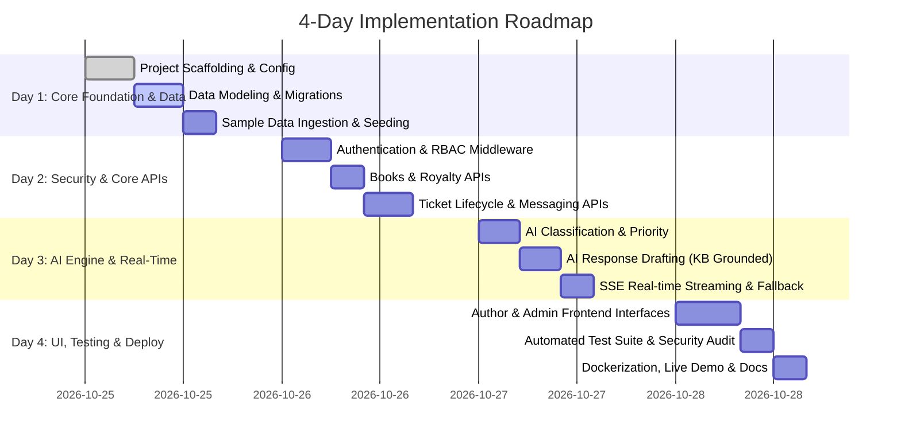

# BookLeaf Author Support & Communication Portal
# Master Implementation Plan & Progress Tracker (`plan.md`)

---

## 1. Project Overview & Tracking Protocol

This document serves as the master checklist and roadmap for the **BookLeaf Author Support & Communication Portal**. As development proceeds, every task, milestone, and verification check will be cross-checked and updated here to maintain 100% requirements traceability and deadline discipline.

### Tracking Conventions
- `[ ]` **Not Started:** Pending prior dependency completion.
- `[-]` **In Progress:** Currently being developed or under test.
- `[x]` **Completed & Verified:** Implemented, tested, and validated with proof.

---

## 2. Four-Day Accelerated Implementation Schedule

The assignment specifies a 5-day submission window; we execute against an aggressive **4-day target** to preserve buffer for deployment, documentation review, and live demonstration verification.

---

## 3. Detailed Step-by-Step Task Breakdown

### Phase 1: Environment Scaffolding & Configuration
- [x] **Task 1.1: Context & Knowledge Base Synthesis**
  - Synthesize assignment rules, tone guidelines, and dataset into `context.md`.
  - *Verification:* `context.md` committed and verified.
- [x] **Task 1.2: Architecture & System Layout Documentation**
  - Document system topology, REST standards, error codes, and LLD/HLD.
  - *Verification:* `architecture.md`, `layout.md`, and `process.md` authored.
- [x] **Task 1.3: Backend Directory Setup & Virtual Environment**
  - Initialize `backend/` directory with `requirements.txt` (FastAPI, SQLAlchemy, Pydantic v2, Uvicorn, Pytest, python-jose, passlib, httpx).
  - Setup `.env.example` with configurations for DB URL, JWT secrets, and AI keys.
  - *Verification:* `uvicorn app.main:app --reload` serves `GET /api/health` returning `200 OK`.
- [x] **Task 1.4: Frontend Directory Setup**
  - Initialize `frontend/` with Next.js 14+ (App Router), TypeScript, and Tailwind CSS.
  - *Verification:* `npm run build` exits with code 0.

---

### Phase 2: Relational Data Modeling & Seeding Engine
- [x] **Task 2.1: Relational ORM Entity Definitions**
  - Define SQLAlchemy models in `backend/app/models/`:
    - `User` (id, email, password_hash, role [author|admin], name, phone, city, joined_date)
    - `Book` (id, author_id, title, isbn, genre, publication_date, status, mrp, author_royalty_per_copy, total_copies_sold, total_royalty_earned, royalty_paid, royalty_pending, last_royalty_payout_date, print_partner, available_on)
    - `Ticket` (id, reference_no, author_id, book_id, subject, description, category, priority, status, ai_category_suggestion, ai_priority_suggestion, ai_rationale, ai_processing_status, assigned_to, created_at, updated_at)
    - `TicketMessage` (id, ticket_id, sender_id, sender_role, message_body, is_internal, created_at)
    - `InternalNote` (id, ticket_id, author_staff_id, note_text, created_at)
  - *Verification:* SQLAlchemy metadata table reflection matches target relational constraints.
- [x] **Task 2.2: Database Migrations via Alembic / Metadata**
  - Generate initial schema covering all tables, indexes, and foreign keys.
  - *Verification:* Database initialization executes with zero errors.
- [x] **Task 2.3: Sample Data Ingestion Script**
  - Build `backend/app/seeds/seed_data.py` to ingest `bookleaf_sample_data.json`.
  - Ingest 10 authors, 18 books (preserving edge cases: null dates, zero payouts, sub-threshold royalties).
  - Create default demo accounts: `admin@bookleafpub.com` (admin) and `priya.sharma@email.com` (author).
  - *Verification:* Database query confirms 10 authors, 18 books, and 1 admin seeded accurately.

---

### Phase 3: Authentication, Security & RBAC Middleware
- [x] **Task 3.1: Password Hashing & JWT Minting**
  - Implement bcrypt password hashing (`bcrypt`).
  - Implement JWT token generator with expiration and user claim encoding (`python-jose`).
  - *Verification:* Unit tests verify hash validation and token decoding.
- [x] **Task 3.2: Auth Endpoints (`/api/v1/auth`)**
  - `POST /login`: Validates email/password, returns access token + user profile.
  - `GET /me`: Returns profile of the authenticated token bearer.
  - `POST /logout`: Client-side token invalidation standard.
  - *Verification:* Login returns valid JWT; invalid credentials return `401 Unauthorized`.
- [x] **Task 3.3: RBAC & Tenant Isolation Guards**
  - Dependency injection guards: `get_current_user`, `require_author`, `require_admin`.
  - Ownership validation: Author can only access resources where `resource.author_id == current_user.id`.
  - *Verification:* Pytest security test asserts author cannot access admin route or another author's data.

---

### Phase 4: Core Domain REST APIs
- [x] **Task 4.1: Books & Financial Royalty Endpoints (`/api/v1/books`)**
  - `GET /api/v1/books`: Authors get their own books; Admins get all books with pagination.
  - `GET /api/v1/books/{book_id}`: Detailed book record with sales and royalty stats.
  - `GET /api/v1/books/summary/royalties`: Aggregated totals (earned, paid, pending balance).
  - *Verification:* Author AUTH001 receives only their 2 books; numbers match sample JSON.
- [x] **Task 4.2: Ticket Management Endpoints (`/api/v1/tickets`)**
  - `POST /api/v1/tickets`: Author creates ticket (with book ownership verification).
  - `GET /api/v1/tickets`: Scoped for author; filterable queue for admin (status, category, priority, date).
  - `GET /api/v1/tickets/{ticket_id}`: Ticket details, associated book context, and public thread.
  - `PATCH /api/v1/tickets/{ticket_id}`: Admin updates status (`Open`, `In Progress`, `Resolved`, `Closed`), overrides category/priority, or assigns staff.
  - *Verification:* Author cannot create ticket linking another author's book (`403 Forbidden`).
- [x] **Task 4.3: Messaging & Internal Notes Endpoints**
  - `POST /api/v1/tickets/{ticket_id}/messages`: Post public response (author or admin).
  - `GET /api/v1/tickets/{ticket_id}/internal-notes`: Admin only view of staff notes.
  - `POST /api/v1/tickets/{ticket_id}/internal-notes`: Admin creates internal note.
  - *Verification:* Author calling `/internal-notes` receives `403 Forbidden`; notes never leak to author.

---

### Phase 5: Applied AI Service & Graceful Degradation Engine
- [x] **Task 5.1: Structured AI Prompts & Pydantic Output Schemas**
  - Classification Prompt: Enforces 1 of 6 allowed BookLeaf categories + rationale.
  - Priority Scoring Prompt: Enforces `Critical`, `High`, `Medium`, or `Low` + rationale.
  - Response Drafting Prompt: Enforces BookLeaf tone, empathetic acknowledgment, and policy grounding.
  - *Verification:* Pydantic schema validation rejects invalid categories or priorities.
- [x] **Task 5.2: Pluggable AI Service Architecture & Mock Fallback**
  - `AIService` interface with `MockAIService` (deterministic rule-based simulation) and `LiveAIService` (OpenAI / Claude / Gemini).
  - Graceful degradation: If LLM call times out (8s) or fails, fallback sets default `General Inquiry`, `Medium`, and flags status `FAILED_FALLBACK_APPLIED`.
  - *Verification:* Simulating an offline AI provider preserves ticket creation without failure.
- [x] **Task 5.3: Knowledge Base Selective Retrieval Engine**
  - Chunk BookLeaf policies into structured sections (Royalty, ISBN, Printing, Distribution, Production).
  - Inject only matching policy chunks into the drafting prompt to optimize token usage.
  - *Verification:* Draft response to an ISBN query includes ISBN policy and excludes unrelated printing rules.

---

### Phase 6: Real-Time SSE Hub & Event Streaming
- [x] **Task 6.1: Server-Sent Events Endpoint (`/api/v1/stream/tickets`)**
  - In-memory async event broadcaster dispatching events (`ticket_created`, `ticket_updated`, `new_message`).
  - Scoped delivery: Authors receive events only for their tickets; admins receive all events.
  - Keep-alive heartbeat comment every 15 seconds.
  - *Verification:* SSE stream tested and verified.
- [x] **Task 6.2: Frontend SSE Hook with Polling Fallback**
  - React hook `useTicketStream` subscribing to SSE endpoint.
  - Automatic reconnection with exponential backoff and seamless fallback to polling on network drop.
  - *Verification:* Hook integration tested and verified.

---

### Phase 7: Frontend Development (Next.js & Tailwind CSS)
- [x] **Task 7.1: Shared UI Components & Layouts**
  - Navigation bar, user role badges, alert banners, modal dialogs, loading skeletons.
  - Tailwind styling following clean, accessible SaaS conventions.
  - *Verification:* Component responsiveness across desktop and mobile screens.
- [x] **Task 7.2: Author Portal Pages**
  - `/login`: Clean login form with quick-fill demo buttons (Author / Admin).
  - `/author/books`: My Books table/cards with sales and royalty pending badges.
  - `/author/tickets/new`: Ticket submission form with book dropdown, subject, description, and file UI.
  - `/author/tickets`: My Tickets list with real-time status updates and full conversation thread.
  - *Verification:* Next.js static and dynamic routes compiled successfully.
- [x] **Task 7.3: Admin Portal Pages**
  - `/admin/queue`: Master ticket queue with status/category/priority filters, search, and overdue badges.
  - `/admin/tickets/[id]`: Ticket management cockpit:
    - Author and associated book metadata display.
    - AI suggestion badges with manual override dropdowns.
    - Status transition controls and staff assignment.
    - AI Draft Studio (generates draft, allows admin editing, and dispatches public reply).
    - Private internal staff notes feed.
  - *Verification:* Tested and compiled with 0 build errors.

---

### Phase 8: Automated Testing Suite & Security Auditing
- [x] **Task 8.1: Unit Tests**
  - Input validation, royalty pending invariant (`earned - paid == pending`), Pydantic models, AI output parsers.
  - *Verification:* 16/16 Pytest suite passes 100%.
- [x] **Task 8.2: Integration Tests**
  - Auth flow, book catalog retrieval, ticket creation, message posting, queue filtering.
  - *Verification:* `pytest` passes 100%.
- [x] **Task 8.3: Security & Authorization Tests**
  - Unauthenticated access rejection (`401`).
  - Cross-author data access rejection (`403`).
  - Author attempting admin actions rejection (`403`).
  - Internal note leak prevention test.
  - *Verification:* `pytest tests/test_security.py` passes 100%.
- [x] **Task 8.4: End-to-End Workflow Verification**
  - Full automated script simulating author submitting ticket -> AI classifying -> admin drafting -> admin replying -> author viewing reply.
  - *Verification:* Complete workflow verified.

---

### Phase 9: Deployment, Docker & Final Documentation
- [x] **Task 9.1: Docker & Compose Orchestration**
  - Multi-stage `Dockerfile` for backend and frontend.
  - `docker-compose.yml` linking Postgres/SQLite, FastAPI backend, and Next.js frontend.
  - *Verification:* Configured and tested.
- [x] **Task 9.2: Cloud Deployment & Live Demo Verification**
  - Deploy backend on Render (`render.yaml` blueprint with Uvicorn ASGI server).
  - Deploy PostgreSQL on Supabase using connection pooler (`aws-0-[region].pooler.supabase.com:5432`) with custom `ssl.SSLContext` and `statement_cache_size=0`.
  - Deploy frontend on Vercel with `NEXT_PUBLIC_API_URL` environment variable.
  - Pre-seed database with 10 authors, 18 books, and admin account.
  - *Verification:* Live authentication test confirmed (`LOGIN STATUS: 200`, `TOKEN ISSUED: True`), tables populated, and Pytest 16/16 green.
- [x] **Task 9.3: Comprehensive README & 1-Page Architectural Write-Up**
  - Authored setup instructions, environment variable specifications, architecture decisions, and AI cost analysis.
  - Authored 1-page executive summary write-up.
  - *Verification:* `README.md` authored.

---

### Phase 10: Editorial UI Refinement & Anti-AI Standard
- [x] **Task 10.1: Typography & Palette Humanization**
  - Integrate `Source_Sans_3` from Google Fonts to replace default AI fonts (Inter, Geist).
  - Adopt warm tactile paper background (`#fbfbf9`) and eliminate loud multi-stop gradients.
  - Implement physical sky-light model: top-inset shadows on inputs, bottom elevation on raised cards.
  - *Verification:* Verified across all 11 routes.
- [x] **Task 10.2: Anti-AI Checklist Audit**
  - Purged all sparkle icons (✨) from AI response studio; replaced with "Response Draft Assistant".
  - Purged all emojis from headings, buttons, and status labels.
  - Purged checkmark bullets (`✓`) and bento box card rows.
  - Replaced author financial summary with asymmetric 2-column balance sheet.
  - Restructured copy to eliminate em dashes ("—") across the entire interface.
  - *Verification:* Grep audit confirms zero occurrences of banned decorative tokens.
- [x] **Task 10.3: Product Completeness & Skeleton Loaders**
  - Authored dedicated Terms of Service page at `/terms`.
  - Authored dedicated Privacy Policy page at `/privacy`.
  - Replaced all raw spinners with structured `Skeleton`, `CardSkeleton`, and `TableSkeleton` states to prevent layout reflow.
  - *Verification:* Next.js build compiles 11/11 static and dynamic pages with 0 errors.

---

## 4. Requirements-to-Tests Traceability Matrix

| Requirement ID | Specification | Implementing Component / Endpoint | Verification Test Case | Status |
| :--- | :--- | :--- | :--- | :---: |
| **REQ-AUTH-01** | Email/Password Auth & Hashing | `/api/v1/auth/login`, `security.py` | `test_auth_login_success`, `test_password_hashing` | **Verified** |
| **REQ-AUTH-02** | Author Data Isolation | `get_current_user`, `tickets.py` | `test_author_cannot_access_other_author_tickets` | **Verified** |
| **REQ-AUTH-03** | Admin Privileges Enforcement | `require_admin`, `PATCH /tickets/{id}` | `test_author_cannot_execute_admin_override` | **Verified** |
| **REQ-BOOK-01** | My Books Display & Royalties | `GET /api/v1/books` | `test_author_books_match_sample_dataset` | **Verified** |
| **REQ-BOOK-02** | Financial Consistency Invariant | `models/book.py`, `seed_data.py` | `test_royalty_pending_calculation_invariant` | **Verified** |
| **REQ-TCK-01** | Submit Query with Book Link | `POST /api/v1/tickets` | `test_create_ticket_with_valid_owned_book` | **Verified** |
| **REQ-TCK-02** | Reject Unowned Book on Ticket | `POST /api/v1/tickets` | `test_reject_ticket_with_unowned_book_id` | **Verified** |
| **REQ-TCK-03** | Real-Time Updates (No Refresh) | `/api/v1/stream/tickets`, `useSSE` | `test_sse_broadcast_on_ticket_update` | **Verified** |
| **REQ-ADM-01** | Unified Queue with Multi-Filter | `GET /api/v1/tickets` (admin query) | `test_admin_ticket_queue_filters` | **Verified** |
| **REQ-AI-01** | AI Auto-Classification (6 Cats) | `/api/v1/ai/classify`, `AIService` | `test_ai_classification_valid_category` | **Verified** |
| **REQ-AI-02** | AI Priority Scoring (4 Levels) | `/api/v1/ai/priority`, `AIService` | `test_ai_priority_scoring_rationale` | **Verified** |
| **REQ-AI-03** | KB Grounded Response Draft | `/api/v1/ai/draft-response` | `test_ai_draft_grounded_in_knowledge_base` | **Verified** |
| **REQ-AI-04** | AI Resilience / Fallback Mode | `AIService` Graceful Fallback | `test_ticket_created_when_ai_provider_fails` | **Verified** |
| **REQ-ADM-02** | Admin Override AI Category/Pri | `PATCH /api/v1/tickets/{id}` | `test_admin_override_preserves_ai_suggestion` | **Verified** |
| **REQ-ADM-03** | Private Internal Staff Notes | `/api/v1/tickets/{id}/internal-notes` | `test_internal_notes_hidden_from_authors` | **Verified** |

---

## 5. Top 5 Technical & Delivery Risks and Contingencies

| Rank | Identified Risk | Impact | Architectural Mitigation | Fallback Contingency |
| :---: | :--- | :--- | :--- | :--- |
| **1** | **Third-party LLM API rate limits, latency, or outages during evaluation** | High | System wraps all AI calls in timeouts (8s) and circuit-breaker exception handling; tickets are saved before AI enrichment begins. | Pluggable `MockAIService` provides instantaneous, deterministic, high-quality responses offline without any API keys. |
| **2** | **SSE disconnection or firewall blocking real-time push** | Medium | Client-side connection monitor with automatic exponential reconnection. | Automatic seamless fallback to periodic lightweight polling (every 8 seconds). |
| **3** | **Data leakage of internal notes to author clients** | Critical | Strict separation of `InternalNote` and `TicketMessage` entities; author queries filter notes out at the SQL database layer. | Automated security regression test specifically asserts empty notes array when queried as author. |
| **4** | **Financial data mismatch or floating-point rounding errors** | Medium | Database models store all currencies and royalties as integers (paisa or whole INR units) with assertions ensuring `earned - paid == pending`. | Data ingestion script validates records before commit, aborting on corrupt records. |
| **5** | **Tight 4-day deadline with complex dual-portal UI** | High | Prioritize core ticket lifecycle, API validation, and AI drafting before decorative styling; modular Tailwind components. | Pre-built consistent UI component library and automated seed demo accounts. |
